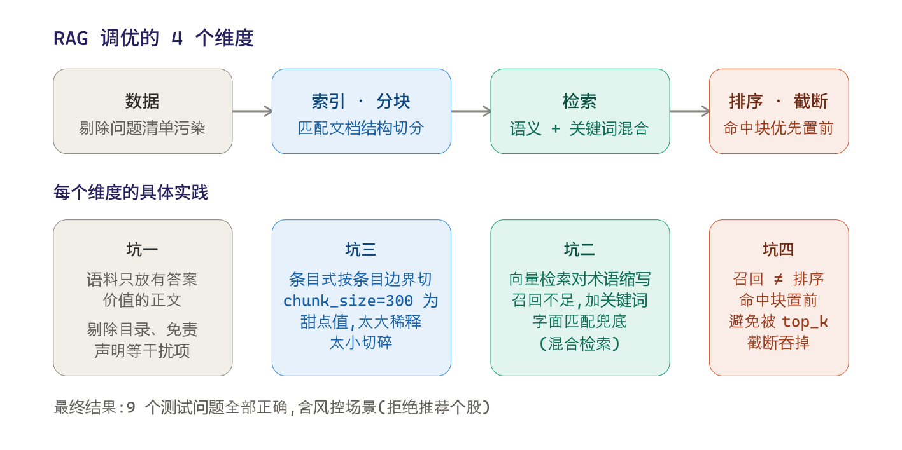

# RAG 检索不准?我的 4 个调优实践

> 一个垂直领域知识库问答项目,从「预设问题答不上来」到「9/9 全通过」的真实调优复盘。
>
> 技术栈:Python · LangChain · Chroma · BAAI/bge-m3 · DeepSeek

---

## 背景

我在做一个「智能知识库 + AI Agent 问答助手」项目,核心链路是经典的 RAG(检索增强生成):

```
文档 → 分块 → 向量化(Embedding) → 存入向量库 → 检索 → 生成
```

用的是一份「股票知识手册」作为语料(约 4400 字,条目式结构)。最初跑通后,我以为大功告成,结果在测试时发现——**手册里预设的几个测试问题,有一半答不上来**,助手只会回复「根据现有资料无法回答」。

于是我开始了排查。整个过程踩了 4 个坑,每一个都是 RAG 工程里非常典型、但网上教程很少讲清楚的问题。这篇博客把它们完整复盘出来。

这 4 个坑,恰好对应了 RAG 流水线上 4 个不同的环节:



---

## 坑一:语料里混入了「问题清单」,污染了检索

### 现象

问「沪深300指数可以直接买入吗?」,助手回答「无法回答」,而且只引用了 `[资料3]`。

### 排查

我打印了检索结果,发现 `[资料3]` 对应的文本块,是文档第 8 节「Agent测试问答样例」——那里面是一份**问题清单**:

```
1. 什么是市盈率PE?
2. A股是T+0还是T+1?
3. 换手率高代表什么?
...
7. 沪深300指数可以直接买入吗?
```

问题来了:这份清单里的句子,和用户的问题**字面一模一样**,所以向量相似度得分极高,总是排在最前面。但它**只有题目、没有答案**——真正含答案的块(比如「基础概念」里讲"指数不能直接买卖")反而被挤出了 top_k 范围。

### 根因

**不是所有放进知识库的文本都是「知识」。** 问题清单、目录、免责声明这类文本,字面匹配度高但信息量为零,会严重干扰检索。

### 解决

把「问答样例」这一节从语料中移除。它本来只是给人工测试用的题面,不该作为可检索的知识。

### 收获

> **知识库要「干净」:只放有答案价值的正文,剔除纯题面、目录、免责声明等干扰项。**

---

## 坑二:纯向量检索对「术语缩写」召回不足

### 现象

删掉问题清单后,大部分问题能答了,但「ROE 指标怎么理解?」「抄底是什么意思?」还是答不上来。

### 排查

我打印了「ROE 指标怎么理解?」的检索排名,发现含 ROE 定义的块排到了**第 11 名**,而「目录」「北向资金」「技术分析提醒」这些完全无关的块反而排在前面。

### 根因

我用的 embedding 是 `bge-m3`,它是**语义检索**。问题是:「ROE」这种英文缩写 + 中文混合的查询,在向量空间里容易被同领域的泛化词稀释——「指标」「收益率」这些词让一堆财经术语块都获得了不低的相似度,而真正含「ROE」的块反而不突出。

这是纯向量检索的经典短板:**对精确术语、缩写、专有名词的召回率低**。语义相似 ≠ 字面包含。

### 解决

引入**混合检索(Hybrid Search)**:在语义检索之外,加一层**关键词字面匹配兜底**——从查询里提取「硬关键词」(英文缩写 + 中文专业词),如果语义检索结果里没有命中这些关键词,就用字面匹配把含关键词的块补充进来。

```
语义检索(向量相似度)  ──┐
                         ├── 合并 → 去重 → 截断 top_k
关键词检索(字面匹配)  ──┘
```

### 收获

> **语义检索解决「意思相近」,关键词检索解决「字面相同」。两者互补,混合检索是 RAG 检索层的标准增强手段。**

---

## 坑三:分块粒度——太大稀释,太小切碎

### 现象

为了让每个知识点独立成块,我把 `chunk_size` 从 500 一路调到了 150,结果反而**更多问题答不上来了**。

### 排查

- `chunk_size=500` 时:6 个基本面指标(EPS、PE、PB、ROE、营收、归母净利润)挤在一个块里,「ROE」的定义被稀释,检索不到。
- `chunk_size=150` 时:每个知识点被切得太碎,一个定义被切成两半,语义不完整,匹配度反而下降。

### 根因

分块粒度是一个**权衡**:

| chunk 太大 | chunk 太小 |
|---|---|
| 一个块混多个知识点,语义被稀释 | 知识点被切断,语义不完整 |
| 检索命中但信息不精准 | 检索命中率下降 |

没有「一刀切」的最优值,取决于文档结构。

### 解决

- `chunk_size=300` 是这份文档的甜点值。
- 更关键的是:**调整切分分隔符(separators)**,把 `\n- `(列表项边界)加入切分优先级,让「条目式」文档能尽量按条目边界切分,而不是生硬按字符数切。

### 收获

> **分块策略要和文档结构匹配:条目式文档优先按条目边界切,叙事型文档按段落/句子切。chunk_size 是兜底,不是主要手段。**

---

## 坑四:兜底结果的「排序」被截断吞掉

### 现象

加了关键词兜底后,ROE 还是答不出来。逻辑上「含 ROE 的块」明明被找到了,但最终没返回。

### 排查

单步调试发现,兜底逻辑里,关键词命中的块被 `append` 到了结果列表的**末尾**,而最后有一步 `return docs[:top_k]` 截断——补进去的块正好落在 top_k 之外,**被截断丢掉了**。

这是一个非常隐蔽的 bug:逻辑上「补进来了」,但排序上「排在了最后」,又被截断「吐出去了」。

### 根因

**召回(补进来)和排序(谁在前)是两回事。** 关键词命中的块说明「字面高度相关」,应该**优先置前**,而不是追加到末尾。

### 解决

把关键词命中的块**插入到结果列表的最前面**(而不是 append 到末尾),再截断 top_k。

### 收获

> **检索结果的「排序」和「截断」是隐藏陷阱:补进来的高质量结果,如果不给高优先级,会被 top_k 截断悄悄丢掉。**

---

## 最终结果:9/9 全部通过

| 测试问题 | 结果 |
|---|---|
| 沪深300指数可以直接买入吗? | ✅ 不能,只能买跟踪指数的基金 |
| ROE 指标怎么理解? | ✅ 净利润÷净资产,衡量公司赚钱能力 |
| 什么是市盈率 PE? | ✅ 市值÷净利润,按利润多少年回本 |
| 换手率高代表什么? | ✅ 交易活跃、筹码交换频繁 |
| A股是 T+0 还是 T+1? | ✅ T+1,次日才能卖 |
| 帮我推荐一只股票? | ✅ 正确拒绝(触发风控) |
| 抄底是什么意思? | ✅ 正确 |
| 止损是什么意思? | ✅ 正确 |
| 北向资金是什么? | ✅ 正确 |

尤其是「推荐股票」这个风控场景——因为文档里明确写了「禁止 AI Agent 直接给买卖建议」,助手正确引用了风险声明并拒绝推荐。这说明 RAG 不仅答对了知识点,还**忠实遵循了语料里约束规则**,这正是 RAG 抑制幻觉、可控可溯源的体现。

---

## 总结

一次「检索不准」的问题,背后是 4 个独立的工程问题:

1. **数据质量**:语料里混入问题清单等干扰项
2. **检索策略**:纯向量检索对术语召回不足,需要混合检索
3. **分块粒度**:太大稀释、太小切碎,要匹配文档结构
4. **排序陷阱**:兜底结果未置前,被 top_k 截断吞掉

这 4 点也大致对应了 RAG 工程的几个经典优化维度:**数据 → 索引(分块)→ 检索 → 重排**。

**RAG 从来不是「跑通就行」,而是「跑通之后,调优才刚刚开始」。** 希望这篇复盘对你踩类似的坑有帮助。
