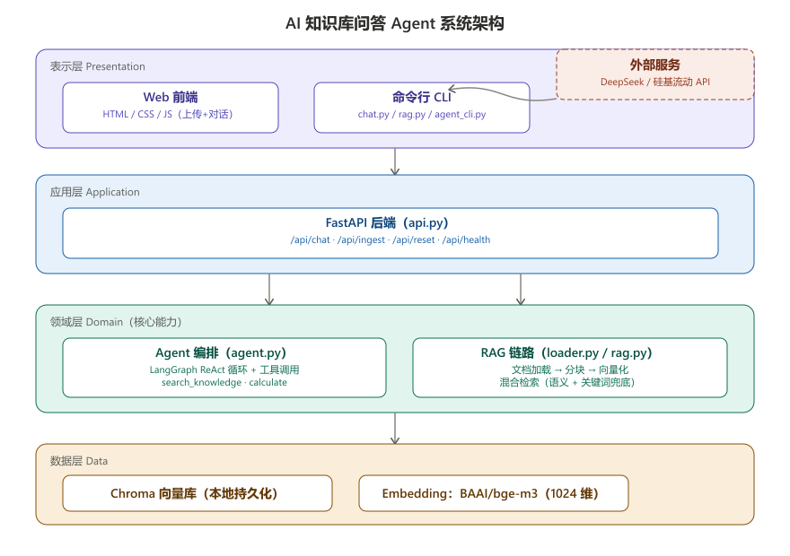
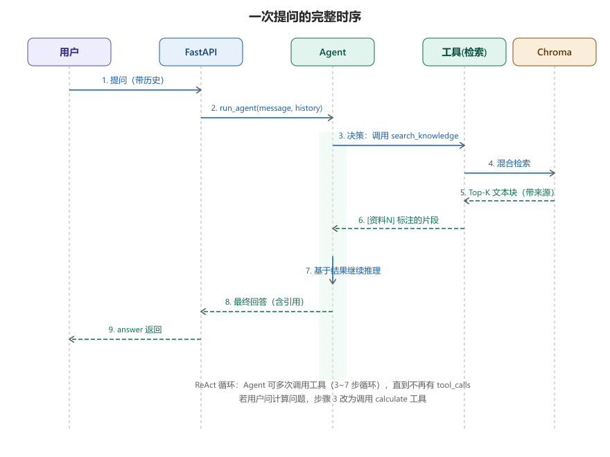

# AI 知识库问答 Agent

基于 **RAG（检索增强生成）+ AI Agent（ReAct 智能体）** 的垂直领域智能问答助手。

上传你的私有文档（PDF / Word / Markdown / TXT），即可用自然语言提问，系统会检索相关内容并**带引用来源地作答**，有效抑制大模型幻觉。

> 目标岗位：大模型应用 / AI Agent 开发工程师 · 独立完成 · 四周迭代

[](https://www.python.org/)
[](https://www.langchain.com/)
[](https://langchain-ai.github.io/langgraph/)
[](https://fastapi.tiangolo.com/)
[](https://www.trychroma.com/)
[](LICENSE)

## 功能特性

- 📄 **多格式文档上传**：支持 PDF / Word / Markdown / TXT，一键建立专属知识库
- 🔍 **混合检索**：语义相似度 + 关键词兜底，中文查询召回更准
- 🤖 **Agent 自主决策**：基于 LangGraph ReAct 循环，AI 自行判断「要不要查库、查几次、要不要计算」
- 🧮 **多工具调度**：知识检索（search_knowledge）+ 数学计算（calculate）
- 💬 **多轮记忆**：支持追问与指代消解（如「它」指代上文）
- 📌 **引用溯源**：回答标注 `[资料N]`，可回溯来源
- 🖥️ **网页界面 + Docker 部署**：开箱即用

## 系统架构



## 一次提问的完整链路



## 技术栈

| 层 | 选型 |
|---|---|
| 语言 | Python 3.11 |
| 大模型 | DeepSeek（OpenAI 兼容接口） |
| Embedding | 硅基流动 BAAI/bge-m3（1024 维） |
| 向量库 | Chroma |
| RAG 框架 | LangChain |
| Agent 框架 | LangGraph（ReAct + Function Calling） |
| 后端 | FastAPI + Uvicorn |
| 前端 | 原生 HTML + CSS + JS |
| 部署 | Docker |

## 快速开始

### 1. 环境准备

```bash
# 要求 Python 3.11
python -m venv .venv

# Windows 激活
.venv\Scripts\activate
# macOS / Linux 激活
source .venv/bin/activate

pip install -r requirements.txt
```

### 2. 配置 API Key

```bash
copy .env.example .env        # Windows
cp .env.example .env          # macOS / Linux
```

编辑 `.env`，填入你的 Key：

```
DEEPSEEK_API_KEY=sk-xxxxxxxx          # 对话模型（deepseek）
SILICONFLOW_API_KEY=sk-xxxxxxxx       # embedding 模型（硅基流动）
```

> Key 申请地址：
> - 对话模型：https://platform.deepseek.com/
> - Embedding 模型：https://siliconflow.cn/

### 3. 网页版（推荐）

```bash
python -m uvicorn app.api:app --host 127.0.0.1 --port 8000
```

浏览器打开 http://127.0.0.1:8000/ ，即可上传文档、对话问答。

接口文档（自动生成）：http://127.0.0.1:8000/docs

### 4. 命令行方式

```bash
# 导入文档建立知识库
python -m app.rag ingest docs/你的文档.pdf

# RAG 问答
python -m app.rag chat

# Agent 对话（自主决策 + 多轮记忆）
python -m app.agent_cli

# 基础聊天（第 1 周）
python app/chat.py
```

### 5. Docker 部署

```bash
docker compose up -d
```

## 项目结构

```
ai-rag-agent/
├── app/                  # 应用代码
│   ├── chat.py           # 命令行聊天（第 1 周）
│   ├── loader.py         # 文档加载与分块（第 2 周）
│   ├── vectorstore.py    # 向量库与混合检索（第 2 周）
│   ├── rag.py            # RAG 问答命令行（第 2 周）
│   ├── tools.py          # Agent 工具定义（第 3 周）
│   ├── agent.py          # ReAct Agent（LangGraph，第 3 周）
│   ├── agent_cli.py      # Agent 交互命令行（第 3 周）
│   ├── network.py        # IPv4 优先网络兼容
│   └── api.py            # FastAPI 后端（第 4 周）
├── frontend/             # 网页界面（第 4 周）
├── docs/                 # 文档、测试语料、架构图、技术笔记
│   ├── assets/           # 架构图、时序图、博客配图
│   ├── 软件需求规格说明书.md
│   ├── 概要设计说明书.md
│   ├── 详细设计说明书.md
│   ├── 测试用例文档.md
│   └── 项目答辩讲稿.md
├── RAG调优实践.md        # 技术博客
├── 面试提纲.md           # 求职面试准备
├── CHANGELOG.md          # 版本记录
├── Dockerfile
├── docker-compose.yml
└── requirements.txt
```

## 技术亮点（面试可讲）

1. **混合检索**：语义相似度 + 中文 n-gram 关键词兜底，解决专业术语、中文查询、多领域混库的召回难题
2. **ReAct 智能体**：LangGraph 图编排，AI 自主决策而非固定流水线
3. **引用溯源**：检索块带来源元数据，Prompt 约束模型标注 `[资料N]`，抑制幻觉
4. **领域解耦**：知识库主题不写死，支持任意领域文档随时切换

详细踩坑经验见 [RAG调优实践.md](RAG调优实践.md) 和 [测试用例文档.md](docs/测试用例文档.md)。

## 路线图（四周）

- [x] 第 1 周：LLM 基础调用 + 环境搭建
- [x] 第 2 周：RAG 知识库（分块 + Embedding + Chroma 检索）
- [x] 第 3 周：Agent 化（工具调用 + 多轮记忆）
- [x] 第 4 周：产品化（FastAPI + 网页 + Docker）

## 文档导航

| 文档 | 说明 |
|---|---|
| [软件需求规格说明书](docs/软件需求规格说明书.md) | 功能/非功能需求、验收标准 |
| [概要设计说明书](docs/概要设计说明书.md) | 架构、模块划分、数据流、部署 |
| [详细设计说明书](docs/详细设计说明书.md) | 算法伪代码、接口定义、异常处理 |
| [测试用例文档](docs/测试用例文档.md) | 23 个用例 + 缺陷回归记录 |
| [项目答辩讲稿](docs/项目答辩讲稿.md) | 面试讲稿 + 高频问答 |

## License

[MIT](LICENSE)
